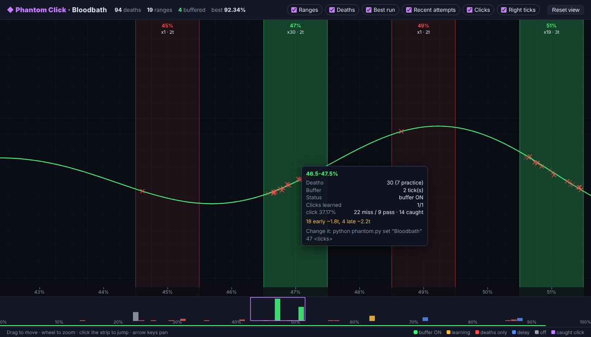

# ◆ Phantom Click

*A Geode mod for Geometry Dash 2.2081.*

Phantom Click learns the clicks you die to. When you click a few ticks too early at one of
them, the mod catches the click, and GD doesn't get it until the right tick. Everywhere
else, your clicks are left alone.


*The level map from the console tool (sample data): death ranges coloured by buffer state,
deaths, your best run, and the stats for a range on hover.*

---

## What's new in v3
- **Death ranges.** Every death counts toward a 1% range: a death at 51% belongs to
  **50.5–51.5%**. The width is adjustable in settings.
- **Per-range ticks from the console.** `python phantom.py` lets you give any range its own
  tick count, switch it off, or put it in delay mode. The game picks changes up on your
  next attempt, so there's no restart.
- **Trajectories.** Your path is recorded every attempt (best run plus the last 5).
  - **In-game overlay** (practice mode by default): range bands, death crosses, learned
    right ticks, and your best and last runs.
  - **Level map** in your browser: `python phantom.py map <level>`. Pan, zoom, hover any range.
- **Data carries over.** Your Death Buffer data is imported automatically the first time you play.

## How it works
1. **Every jump click is graded** on the exact tick GD applies it. If you die within 0.75 s,
   it's a **miss**. If you're still alive, it's a **pass**.
2. **Misses create click spots**, each linked to the death range it kills you in. Your passes
   teach the spot its **right tick**, which updates every attempt.
3. **At a spot with a right tick**, a click up to *N* ticks early (N = that range's ticks,
   default 2) is caught and given to GD on the right tick. It's never held longer than N.
   On-time and late clicks go straight through.
4. **If caught clicks keep dying** at a spot (2 in a row), it re-learns from your next pass.

### Range modes (set in the console)
| Mode | What happens in that range |
|---|---|
| **smart** (default) | Early clicks at clicks you've died to are held until the learned right tick (up to N ticks). |
| **delay** | *Every* click inside the range is held exactly N ticks, with no learning needed. Use it when you know you always click early there. |
| **off** (0 ticks) | Nothing is buffered in that range. |

---

## Update from Death Buffer (step by step)

**1. Put the new files on GitHub**
1. Extract `phantom-click.zip`: right-click → **Extract All** → **Extract**.
2. Open your repo on GitHub → **Add file** → **Upload files**.
3. Open the extracted folder, press **Ctrl+A**, and drag everything onto the page.
   Then click **Commit changes**.
4. *(Optional)* To rename the download: open `.github/workflows/build.yml` on GitHub,
   click the pencil, change `name: Death Buffer` to `name: Phantom Click`, and commit.

**2. Build**
1. Open the **Actions** tab. If no new run starts, click **Build Geode Mod** → **Run workflow**.
2. Wait for the green check, open the run, and download the artifact under **Artifacts**.
3. Extract it to get `local.phantom-click.geode`.

**3. Install**
1. Close Geometry Dash.
2. Steam → right-click **Geometry Dash** → **Manage** → **Browse local files** → `geode` → `mods`.
3. **Delete `local.death-buffer.geode`.** Both mods catch clicks, so they must not run together.
4. Copy `local.phantom-click.geode` in and start the game.
   Your old deaths and learned clicks are imported automatically.

**4. Console tool**
1. Python from **python.org**, with **Add Python to PATH** ticked.
2. Open CMD in the extracted folder (type `cmd` in File Explorer's address bar and press Enter).
3. Run `python phantom.py`.

---

## The console: `phantom.py`
```
python phantom.py                         menu: pick a level, then type commands
python phantom.py levels                  every level, deaths, ranges, buffer status
python phantom.py show bloodbath          that level's death ranges, worst first
python phantom.py set bloodbath 51 3      3 ticks in 50.5-51.5%
python phantom.py set bloodbath 51 2 delay   hold every click there exactly 2 ticks
python phantom.py set bloodbath 51 off    no buffer in that range
python phantom.py clear bloodbath 51      back to the default ("all" for every range)
python phantom.py map bloodbath           open the level map
```
Inside the menu, just type `51 3`, `51 off`, `all 3`, `map` or `b`.

`show` also tells you how you miss each range. For example, *18 early ~1.8t, 4 late ~2.2t*
means you're mostly early there, by about 2 ticks, so 2–3 ticks of buffer fits. If a range
is mostly *late*, the buffer can't help: it can't make a click earlier.

## In-game overlay
Geode mod list → **Phantom Click** → ⚙ → **Show overlay**: *Off / Practice only / Always*.

| Colour | Meaning |
|---|---|
| 🟩 green | buffer ON. The label shows deaths and ticks, e.g. `51%  x19  3t ON`. |
| 🟨 amber | learning. Get past that click once. |
| 🟥 red | deaths, but no click to blame yet |
| 🟦 blue | delay range |
| ⬜ grey | off |

Also drawn:
- **Red crosses:** your deaths.
- **Green flags:** learned right ticks.
- **Green line:** your best run, with cyan dots where you clicked and purple dots where the
  mod caught a click.
- **White line:** your last attempt.

## Watch it live
Geode mod list → **Geode** → ⚙ → **Show Platform Console**, then restart:
```
Phantom Click on "Bloodbath": 94 death(s) logged, 6 click spot(s), 2 with the buffer ON
[console] 3 range rule(s) active for "Bloodbath"
[buffer] caught a click 2 tick(s) early at 50.91% (50.5-51.5%) and sent it on the right tick
[death] 47.12% | range 46.5-47.5% (30 death(s), 2 tick(s) smart) | last click at 46.80% was 1.8 tick(s) early (...)
[learned] click spot 62.80% (62.5-63.5%): right tick found - buffer ON, 3 tick(s)
[trail] new best run saved (92.34%)
```
Nothing is printed or saved while you're alive mid-attempt, so the mod never causes a stutter.

## Settings (Geode mod list → Phantom Click → ⚙)
| Setting | Default | What it does |
|---|---|---|
| Catch early clicks | on | Master switch for buffering. Learning, logging and trails keep running. |
| Default ticks per range | 2 | Ticks for ranges you haven't set in the console |
| Death range width | 1% | 1 → a death at 51% counts in 50.5–51.5% |
| Misses before buffering | 1 | Misses needed at a click before it's buffered |
| Judge time | 0.75 s | Die within this long after a click = miss. Raise it for long jumps or fast speeds. |
| Same-click distance | 1 block | Clicks this close are the same click |
| Count practice deaths | on | Practice passes always count, so practice is where you teach it |
| Show overlay | Practice only | Draw ranges, deaths, right ticks and trails in the level |
| Show trails | on | Best run and last attempt on the overlay |
| Console log | on | Print deaths, learning, caught clicks and summaries |

## Files
Data lives in `%LOCALAPPDATA%\GeometryDash\geode\mods\local.phantom-click\`:
- `deaths.json`: every death (exact % and position) and every click spot.
- `ranges.json`: your per-range settings, written by the console.
- `trails\`: recorded runs per level.
- `maps\`: level maps.

## Notes
- Platformer levels are skipped. Player 1's jump only, and dual mode isn't buffered.
- If you use Click Between Frames, test with it on and off. Both mods change input timing.
- Runs made with Phantom Click are input-assisted and don't count for leaderboards or list submissions.
- For developers:
  - `src/learner.hpp` (learning and buffering) and `src/trail.hpp` (trajectories) have no
    game code in them.
  - `tests/` simulates attempts against both: `clang++ -std=c++20 tests/test_learner.cpp -o t && ./t`.
